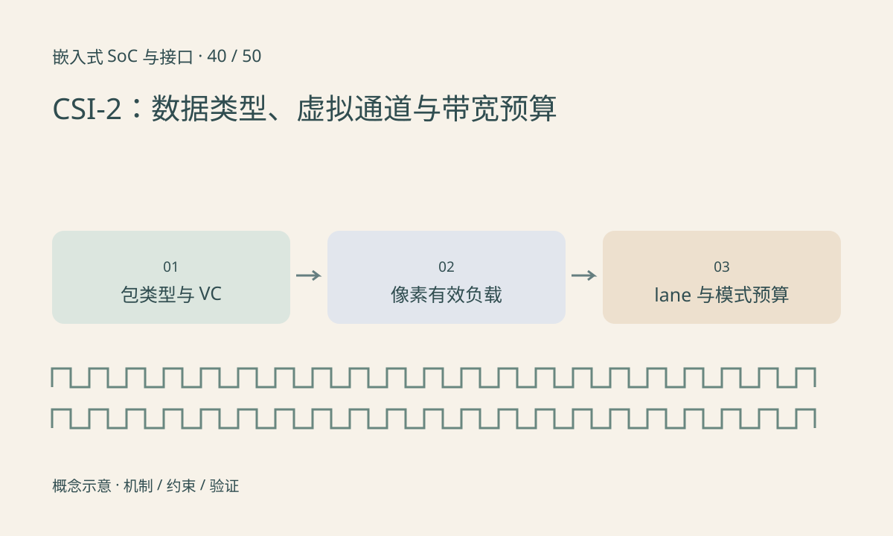

> 第 40 / 50 课 · 核心课程。返回[课程合集](/series/embedded-soc-interfaces/)。

## 帧内容由模式和包信息共同解释

CSI-2 传输使用包及数据标识等机制表达内容，数据类型帮助区分 RAW 位深等负载，虚拟通道用于区分逻辑流。实际支持的通道数量和扩展取决于版本与实现，不能认为配置一个 VC 就能凭空增加物理带宽。

RAW10 的有效像素为每像素十位，但接收后内存可能按更宽容器保存。线上打包字节与 DDR 中的 stride、平面布局应分别核对，不能用一个文件大小同时解释两者。

## 有效像素速率只是下界

1920×1080、30fps、RAW10 的有效数据速率为 622.08Mbit/s。理想平均分到两条数据 lane 是 311.04Mbit/s/lane，但还未包含包开销、传输调度和模式要求。

空白时间未必等同于传输同尺寸的空白像素包，不能简单把所有视频接口的 blanking 公式套过来。最终使用 sensor 模式给定的链路频率、时序和接收端限制，再检查余量。

## 错误计数提供方向而非唯一答案

CRC、头部纠错相关计数、同步错误和帧尺寸异常对应不同检查点，但不能仅凭一个计数器就断言 PCB 有问题。lane 映射、速率、时序窗口、格式配置和信号质量都需要核对。



## 练习与参考结论

代码计算有效负载和一个明确标注为假设的 20% 预算余量。该余量不是 MIPI 标准规定，也不替代实际 mode 参数。

把位深从 10 改成 12，帧率从 30 改为 60，观察预算如何增长；然后分别计算接收后 16 位容器的 DDR 写入量，解释为什么两个速率不同。

### 配套代码

下载包包含独立运行所需文件，使用 Python 标准库；这里验证机制和计算，不代表开发板测量结果。

```experiment
practice
```

## 延伸阅读

- [官方资料：CSI-2：数据类型、虚拟通道与带宽预算](https://www.mipi.org/specifications/csi-2)

[上一课：摄像头接入：供电、复位、MCLK 与配置](/posts/soc-39-sensor-bringup.html) · [下一课：显示链路：DSI、RGB、LVDS 与 HDMI](/posts/soc-41-display-interfaces.html)
