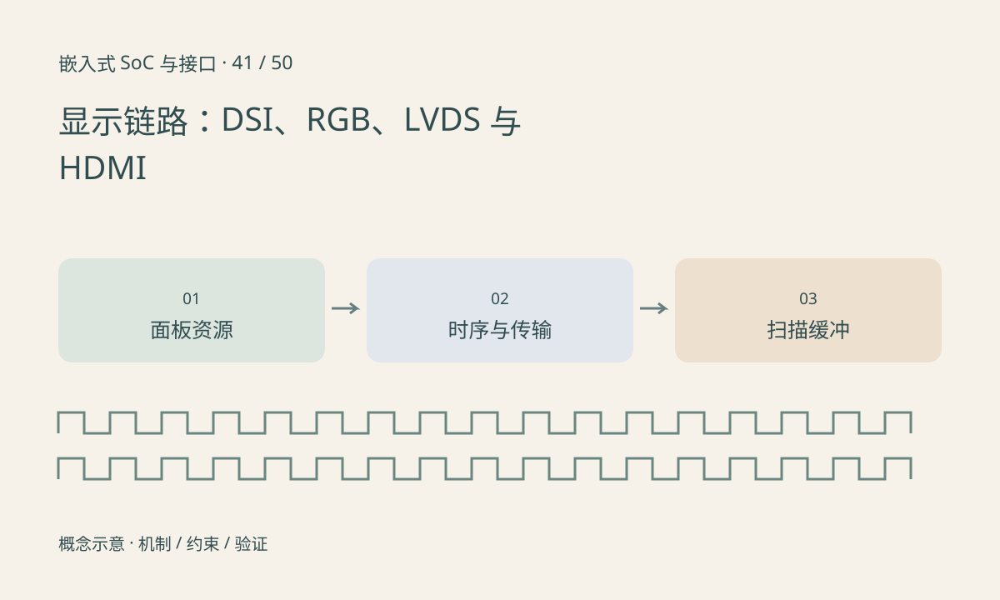

> 第 41 / 50 课 · 核心课程。返回[课程合集](/series/embedded-soc-interfaces/)。

## 接口名字不替代面板规格

并行 RGB、LVDS、DSI 与 HDMI 的物理连接和协议机制不同。LVDS 本身描述电气传输方式，具体显示映射还需核对；不能把所有差分显示线直接归为同一种接口。

面板可能需要供电时序、reset 和命令初始化，背光亮只证明背光路径部分工作。DSI 的命令与视频模式需要面板和主控支持；桥接芯片又增加一段独立配置。

## 有效分辨率不是完整时序

对使用像素扫描时序的模式，水平总像素与垂直总行包含前后肩和同步等区间。像素时钟常按总宽×总高×刷新率计算，而不只是可见宽×可见高。具体链路还受编码、打包和时钟模式影响。

显示缓冲的像素格式、stride 和刷新同步也需正确。CPU 在扫描过程中直接修改同一缓冲可能产生撕裂，双缓冲仍需在正确时机切换，并等待缓冲不再被扫描后复用。



## 练习与参考结论

构造水平总长 2200、垂直总高 1125、60Hz，像素时钟为 148.5MHz。该例不授权给任意 1080p 面板使用，必须匹配具体 mode。

黑屏排查分成供电/背光、复位与初始化、链路时钟、有效时序、缓冲内容。用可控纯色或棋盘测试区分像素格式与业务绘制问题。

### 配套代码

下载包包含独立运行所需文件，使用 Python 标准库；这里验证机制和计算，不代表开发板测量结果。

```experiment
practice
```

## 延伸阅读

- [官方资料：显示链路：DSI、RGB、LVDS 与 HDMI](https://www.mipi.org/specifications/dsi-2)

[上一课：CSI-2：数据类型、虚拟通道与带宽预算](/posts/soc-40-csi-bandwidth.html) · [下一课：设备树、probe、IRQ 与资源生命周期](/posts/soc-42-linux-driver-resources.html)
