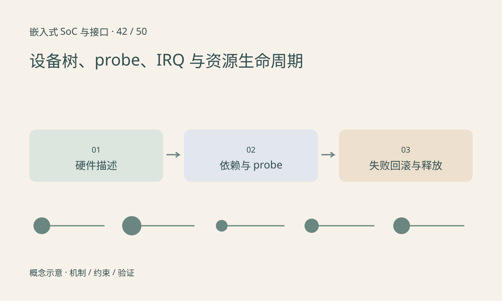

> 第 42 / 50 课 · 核心课程。返回[课程合集](/series/embedded-soc-interfaces/)。

## 设备树描述连接与资源

compatible 用于匹配驱动，reg、interrupts、clocks、resets、供电和 pinctrl 等属性描述资源关系。每类设备的绑定有自己的规定，不能凭名称猜格式或复制不匹配的节点。

设备树有节点不表示驱动已经编入或加载。驱动匹配后，依赖资源尚未就绪可能引发 deferred probe；这与“设备不存在”不同。应结合绑定文档、日志和资源提供者查证。

## 初始化和撤销必须成对

典型驱动获取资源、上电、开时钟、解除复位、配置硬件和注册服务，实际顺序由硬件要求决定。失败路径需要撤销已经完成的步骤，而不是只在完整成功时才考虑 cleanup。

移除或挂起前先阻止新请求，再停止硬件并处理未完成 DMA/中断，最后释放缓冲。devm 能管理许多资源释放，但不会自动理解设备停止与异步任务结束的全部语义。

## 练习与参考结论

编写纸上 probe 状态表，在每一步注入失败，检查先前获取的资源如何释放。重点观察中断尚未关闭就释放缓冲的顺序错误。

只读核对实际运行 DT 与源码是否一致，再查驱动绑定和 probe 日志。本文不提供未经平台确认的 DTS 寄存器地址，也不在本机加载教学内核模块。

## 延伸阅读

- [官方资料：设备树、probe、IRQ 与资源生命周期](https://docs.kernel.org/devicetree/usage-model.html)

[上一课：显示链路：DSI、RGB、LVDS 与 HDMI](/posts/soc-41-display-interfaces.html) · [下一课：实时性、中断延迟与优先级反转](/posts/soc-43-realtime-scheduling.html)
