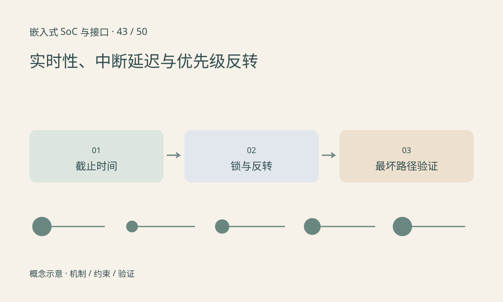

> 第 43 / 50 课 · 核心课程。返回[课程合集](/series/embedded-soc-interfaces/)。

## 实时关注截止时间

吞吐高、平均延迟低，不表示每次都满足 deadline。一个周期任务可能因中断屏蔽、锁竞争、缺页、I/O 或高优先级工作而偶发超时。需要定义允许的最坏响应和超时后的行为。

RTOS 或 PREEMPT_RT 为构建低延迟系统提供机制，不保证任意驱动和应用都自动满足硬实时。测量结果也只覆盖测到的负载条件，应结合设计分析与压力覆盖。

## 优先级反转发生在共享资源上

高优先级任务等待低优先级任务持有的锁，中优先级任务又抢占低任务，导致高任务被间接阻塞。优先级继承可以缓解这种情形，但不能消除长临界区、死锁或不受该锁机制管理的等待。

让所有线程都最高优先级不是解决方案。还应缩短临界区，避免在关键路径做不可控 I/O，定义 CPU 亲和性和中断关系，并评估系统整体饥饿风险。

## 练习与参考结论

纸上按时间轴安排 H、M、L 三个任务与一把锁，分别画出有无继承时 H 的阻塞时间。另计算示例 `C=2ms、阻塞=3ms、deadline=4ms`，仅两项已超过时限，应修改设计。

板端测试要记录长尾、最大值、测试时长和负载。没有实际运行实时测量工具时，不用 Python sleep 的结果声称系统满足实时性。

## 延伸阅读

- [官方资料：实时性、中断延迟与优先级反转](https://docs.kernel.org/locking/rt-mutex-design.html)

[上一课：设备树、probe、IRQ 与资源生命周期](/posts/soc-42-linux-driver-resources.html) · [下一课：万用表、示波器、逻辑分析仪与 JTAG](/posts/soc-44-debug-instruments.html)
