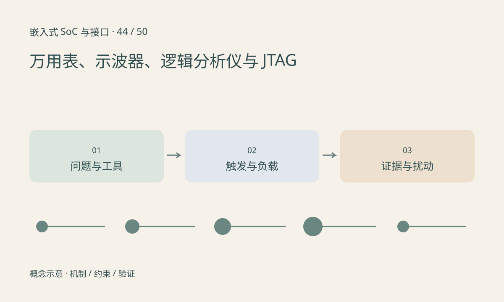

> 第 44 / 50 课 · 核心课程。返回[课程合集](/series/embedded-soc-interfaces/)。

## 不同工具回答不同问题

万用表适合稳态电压、电阻等检查，但可能看不到短暂跌落。示波器观察模拟波形、边沿与相对时序。逻辑分析仪适合多路数字事件和协议解码，但二值采样不能证明电压裕量或高速眼图。JTAG/SWD 用于相应处理器调试访问，能力受芯片和安全配置限制。

协议解码显示错误可能来自采样率、阈值或极性设置，并非设备真的发错。示波器带宽、采样、探头衰减、负载与接地会改变观察结果。普通接地探头的地夹可能与保护地相连，跨地或带电电源测量必须采用合适方法，不能随意夹接。

## 停机调试会改变系统

断点暂停 CPU 后，外设 DMA、另一个核和看门狗可能继续运行。单步正常而全速异常，提示并发和时间依赖；不能把暂停后看到的状态当作原始故障瞬间。

硬件 trace、时间戳日志和触发输出可减少停机影响，但本身也有带宽与扰动。设计一个短 GPIO 标记能帮助关联软件事件与波形，仍需计入插桩成本。

## 练习与参考结论

为“偶发复位”选择同时捕获电源、reset 和负载标记；为“I²C 读错地址”捕获 SDA/SCL 并保留模拟幅度检查。说明各自触发条件。

记录工具型号、探头、带宽限制、采样率、阈值、接地点和触发设置。只保存一张没有标尺和时间信息的截图，不足以支持时序结论。

## 延伸阅读

- [官方资料：万用表、示波器、逻辑分析仪与 JTAG](https://openocd.org/doc/html/General-Commands.html)

[上一课：实时性、中断延迟与优先级反转](/posts/soc-43-realtime-scheduling.html) · [下一课：综合排障：无图、花屏、丢帧与 NPU 慢](/posts/soc-45-system-troubleshooting.html)
