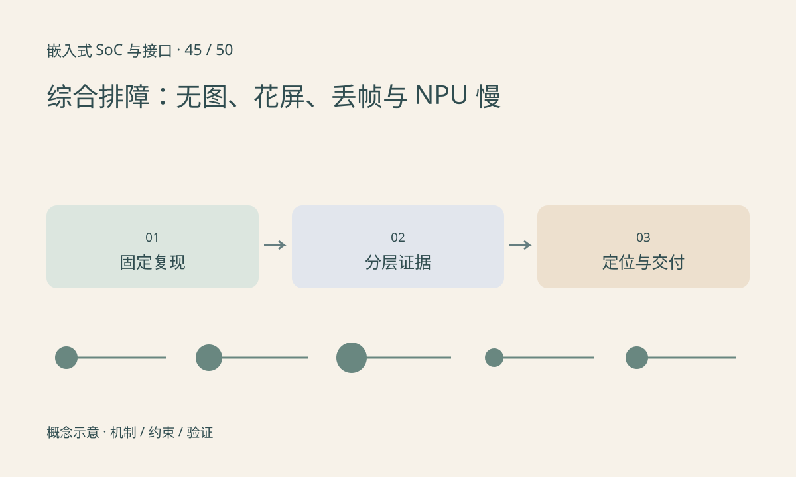

> 第 45 / 50 课 · 核心课程。返回[课程合集](/series/embedded-soc-interfaces/)。

## 先固定失败条件

记录板卡版本、固件、设备树、传感器模式、模型、输入、供电和复现步骤。修改一个变量后保留前后结果，避免同时换固件、排线和模型，导致问题消失却无法知道原因。

无图先沿供电→控制总线→出流→接收→格式→ISP→业务定位；花屏先保存原始数据并核对位深、Bayer、stride 和颜色布局，再看信号错误；丢帧同时查输入速率、队列、处理时间和资源争用。

## 性能故障也需要数据路径

NPU 计算快而业务慢，可能耗在预处理、复制、CPU 回退或队列。分别记录采集时间、提交时间、设备完成时间和消费时间。通过固定输入回放去掉摄像头变量，再逐段恢复实时链路。

恢复策略与根因分析分开。重启可恢复业务，但需保留出错前证据；持续复位不应覆盖所有日志。缓冲超时后也不能在设备仍访问时直接复用。

## 交付可复核结论

报告写明观察事实、假设、验证动作和结论边界。例如“降低 CSI 速率后 CRC 错误消失”说明问题与该条件相关，尚不能单凭这一条证据证明某根走线不合格。



## 练习与参考结论

包内构造三条故障记录，由脚本计算帧龄和队列积压，不接硬件。找出处理耗时正常但输入已经很旧的记录。

最终作业：提交系统框图、模式表、带宽预算、启动时间线、故障树与一份实际测量报告。没有设备时先完成前五项，测量项明确记为未执行。

### 配套代码

下载包包含独立运行所需文件，使用 Python 标准库；这里验证机制和计算，不代表开发板测量结果。

```experiment
practice
```

## 延伸阅读

- [官方资料：综合排障：无图、花屏、丢帧与 NPU 慢](https://docs.kernel.org/trace/ftrace.html)

[上一课：万用表、示波器、逻辑分析仪与 JTAG](/posts/soc-44-debug-instruments.html) · [下一课：选修：Wi-Fi、Bluetooth 与蜂窝通信](/posts/soc-46-wireless.html)
