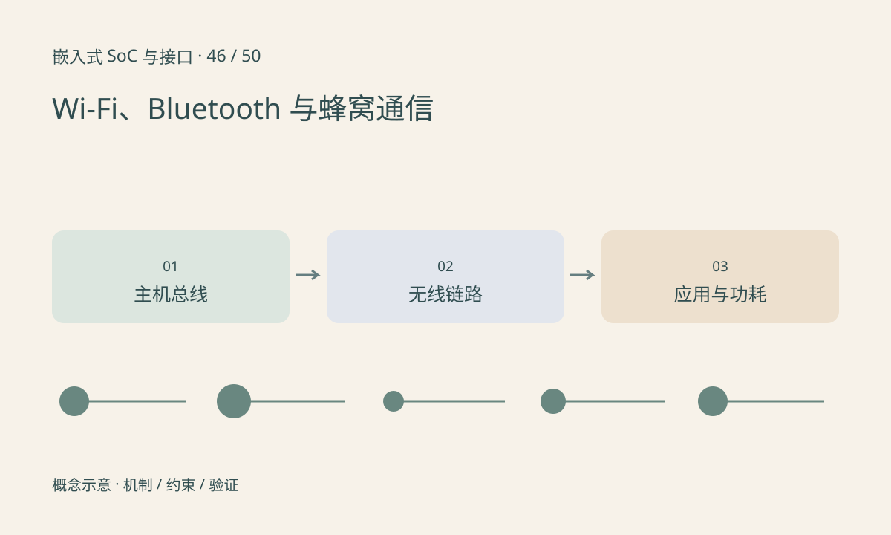

> 第 46 / 50 课 · 扩展选修。返回[课程合集](/series/embedded-soc-interfaces/)。

## 模块接入与无线连接是两条路径

无线模块可能通过 SDIO、PCIe、USB 或 UART 与主机通信，这只是主机侧连接。Wi-Fi 关联、Bluetooth 连接或蜂窝网络注册涉及另外的无线协议和配置。驱动识别模块不等于获得网络业务能力。

还需要固件、校准数据、天线、供电和区域配置。天线摆放和外壳变化可能改变表现，不能把串口上收到 OK 当作射频链路正常的证明。

## 指标应按业务测量

标称 PHY 速率不是应用吞吐，重传、干扰、共享信道和省电策略会影响延迟。低功耗连接的唤醒周期可能增加响应时间。蜂窝模块的发射瞬态还可能暴露供电问题。

协议版本与模块特性变化很快，具体能力应查目标模块手册。课程只建立分层方法，不给所有 Wi-Fi 或 Bluetooth 设备统一的距离和速率承诺。

## 练习与参考结论

将一次“无法上传图像”拆为主机枚举、固件就绪、无线连接、IP/路由、DNS/TLS 和应用请求。为每层选择一个可观察证据。

测试表同时记录信号环境、天线、距离、供电、包大小、重传和功耗状态。不要在未控制环境时用两次速度测试断言模块性能优劣。

## 延伸阅读

- [官方资料：选修：Wi-Fi、Bluetooth 与蜂窝通信](https://wireless.docs.kernel.org/en/latest/en/developers/documentation.html)

[上一课：综合排障：无图、花屏、丢帧与 NPU 慢](/posts/soc-45-system-troubleshooting.html) · [下一课：选修：工业以太网、EtherCAT 与 TSN](/posts/soc-47-industrial-network.html)
