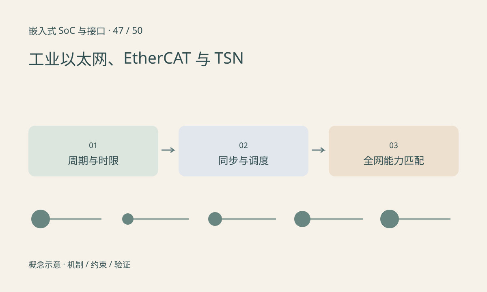

> 第 47 / 50 课 · 扩展选修。返回[课程合集](/series/embedded-soc-interfaces/)。

## 能传以太帧不等于具备确定性

工业系统除了数据正确，还关心周期、抖动、丢失处理和时间一致性。普通以太网硬件支持基本通信，不表示自动支持每种工业协议或时间调度能力。

EtherCAT 采用专门的数据处理和设备机制，不能当作把 UDP 线程调高优先级就能等价实现。TSN 是一组时间敏感网络相关机制，不是某一个“实时以太网接口”。所需特性必须由端系统、交换设备和网络配置共同满足。

## 同步时钟不是自动满足截止时间

时钟同步使节点能够比较时间，但排队、调度、链路负载和端点执行仍会影响响应。设备标称支持硬件时间戳，也需确认时间戳位置和时钟域，不能把应用打印时间当作线上准确时间。

安全功能、功能安全认证和通信实时性也不是同一概念。涉及产品标准时应按适用版本和认证流程执行，本课不替代合规设计。

## 练习与参考结论

给一个 1ms 周期控制链分配传感、传输、计算和执行预算，并明确每段最大抖动。若网络只保证平均 100µs，是否足以证明最坏周期达标？答案是否定的。

作业输出支持矩阵：端点、交换机、时间同步、调度机制和测量位置；无法证实的能力写“未知”，不靠协议名称补全。

## 延伸阅读

- [官方资料：选修：工业以太网、EtherCAT 与 TSN](https://www.ethercat.org/en/technology.html)

[上一课：选修：Wi-Fi、Bluetooth 与蜂窝通信](/posts/soc-46-wireless.html) · [下一课：选修：FPGA、流水线与时序约束](/posts/soc-48-fpga.html)
