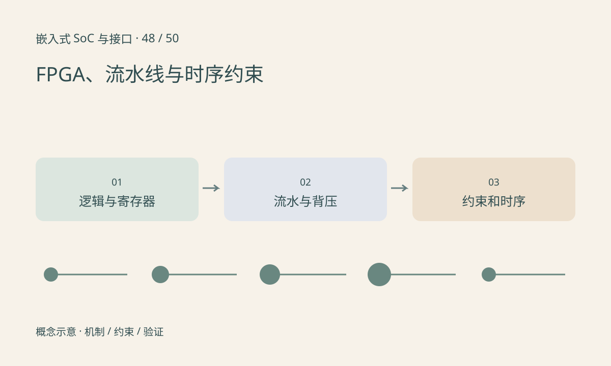

> 第 48 / 50 课 · 扩展选修。返回[课程合集](/series/embedded-soc-interfaces/)。

## HDL 描述硬件关系

FPGA 通过可配置逻辑、寄存器、片上存储和专用算术等资源构造电路。HDL 中描述的并行结构不等于 CPU 按行执行。综合、布局布线和时序分析把设计映射到具体器件。

流水线增加寄存级数可以缩短每级组合路径，提高可运行时钟，但会改变延迟。每拍接收一个输入是吞吐能力，经过多拍得到结果是流水延迟，两者应分别说明。

## 时序和 CDC 必须显式约束

功能仿真通过不保证 setup/hold 满足，也不保证引脚、电压和时钟正确。跨时钟域需要专门结构与分析，不能通过随意标记 false path 来掩盖真实数据传递问题。

FPGA 中的 DSP slice 是专用算术资源，与独立可编程 DSP 处理器不是同一个东西。带 ARM 核的 FPGA SoC 还需要软件和逻辑之间的寄存器、DMA 与缓存协议。

## 练习与参考结论

纸上设计三拍乘加流水线，列出第 1～6 拍输入和输出对应关系，再加入 valid/ready 背压，说明停顿时哪些寄存器必须保持。

没有工具链和目标板时只完成结构与时序表。真实交付还需约束文件、时序报告、资源报告、仿真与板级测量，不能以 Python 功能模型代替时序收敛。

## 延伸阅读

- [官方资料：选修：FPGA、流水线与时序约束](https://docs.amd.com/r/en-US/ug903-vivado-using-constraints)

[上一课：选修：工业以太网、EtherCAT 与 TSN](/posts/soc-47-industrial-network.html) · [下一课：选修：长距离视频 SerDes 与 A-PHY](/posts/soc-49-camera-serdes.html)
