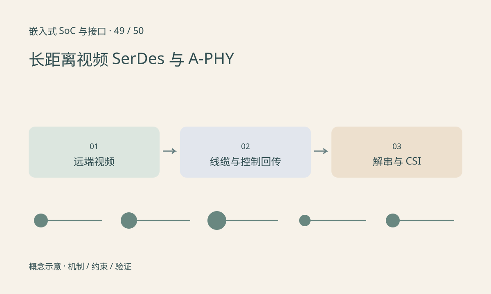

> 第 49 / 50 课 · 扩展选修。返回[课程合集](/series/embedded-soc-interfaces/)。

## 远端摄像头增加了中间链路

传感器的本地视频接口可以连接串行器，经线缆到解串器，再接入主控。反向控制通道可能承载寄存器访问或其他信号，但具体能力依产品协议。某些系统还通过线缆供电，需要单独设计滤波、保护与启动条件。

GMSL、FPD-Link 与 MIPI A-PHY 是不同技术或规范体系，不能因都使用同轴或双绞线就假设互通。端点、代际、传输模式与桥接器件需要明确匹配。

## 锁定不等于有效图像

链路 lock 只说明某一层达到锁定条件。仍需检查远端 sensor 出流、控制别名或地址映射、CSI 输出格式、同步和包错误。多路摄像头合并时，逻辑通道与物理带宽预算也要核对。

线缆、连接器、温度和供电变化可能暴露边缘裕量。故障注入应在专用测试环境下进行，并保留每端状态与时间，不能只记“偶尔黑屏”。

## 练习与参考结论

画出 sensor→串行器→线缆→解串器→CSI 接收器，并为每段标出控制、数据、供电和错误计数来源。

构造“反向 I²C 可读、链路已锁、无 CSI 帧”的情形，列出仍未验证的步骤。不要跳过 sensor stream-on 与解串器输出配置，直接更换主控 ISP 参数。

## 延伸阅读

- [官方资料：选修：长距离视频 SerDes 与 A-PHY](https://www.mipi.org/specifications/a-phy)

[上一课：选修：FPGA、流水线与时序约束](/posts/soc-48-fpga.html) · [下一课：选修：温度、功耗、EMC 与长期可靠性](/posts/soc-50-reliability-validation.html)
