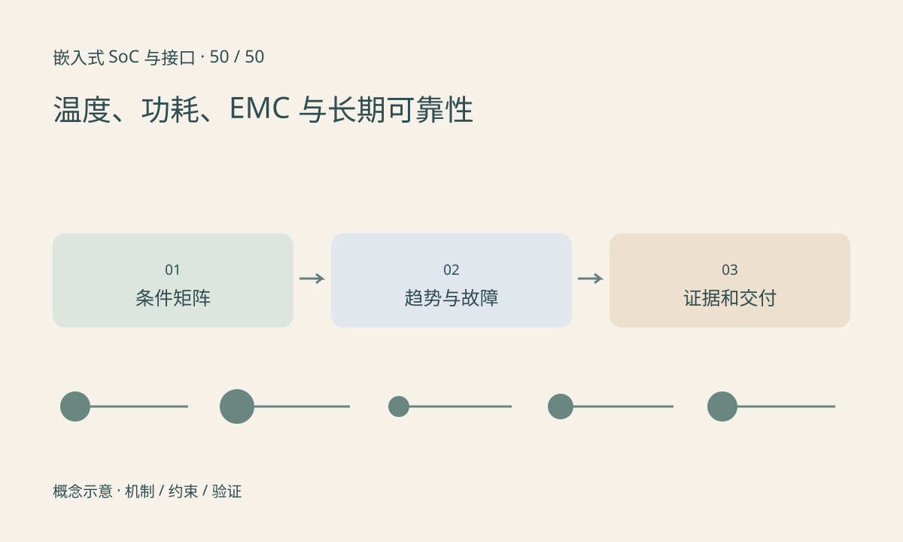

> 第 50 / 50 课 · 扩展选修。返回[课程合集](/series/embedded-soc-interfaces/)。

## 单次运行成功只覆盖很小的条件空间

温度、供电、负载、外设组合和长时间运行会改变系统行为。计算负载增加可能升温并触发降频，供电瞬态可能复位，队列或引用泄漏可能在很久以后耗尽资源。

建立测试矩阵时区分工作边界、绝对最大值和额定应用条件。不能以超出规格的实验结果替代正常条件可靠性，也不能在不了解仪器和电气风险时进行随意高压或干扰注入。

## 记录趋势与恢复能力

除平均帧率外，记录尾延迟、温度、频率、内存、错误计数和恢复次数。每个测试版本固定固件、模型、配置和硬件编号，出现异常时保留前后窗口。

EMC 与 ESD 测试有规定方法和判据；实验室随手碰线或靠近手机只是排障线索，不是认证。看门狗、A/B 与自动重连提高恢复能力，但不能代替根因修复。

## 用交付矩阵收尾

本系列到这里建立硬件、驱动和系统的共同语言。按项目继续深入无线、FPGA 或高速 PCB 即可，不要求对所有标准无限扩课。

## 练习与参考结论

设计 24 小时运行记录模板，但不要把未执行的测试填成通过。每小时采样温度、频率、内存和错误计数，对故障按影响与可恢复性分类。

最终报告分“已验证”“条件有限”“未执行”，每项关联原始证据。硬件合规与可靠性试验需使用适用标准、合格设备和明确测试条件。

## 延伸阅读

- [官方资料：选修：温度、功耗、EMC 与长期可靠性](https://docs.kernel.org/driver-api/thermal/sysfs-api.html)

[上一课：选修：长距离视频 SerDes 与 A-PHY](/posts/soc-49-camera-serdes.html)
