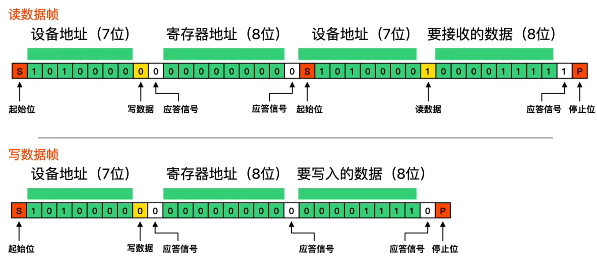

# I2C 总线
I2C（Inter-Integrated Circuit，集成电路间通讯）是一种用于在多个集成电路之间进行数据交换的协议，它使用 two-wire（两线）通信协议，通常由两个 GPIO（通用输入输出）引脚组成，通常为 SDA（数据线）和 SCL（时钟线）。I2C 总线具有以下特点：
* 半双工通信：在同一时间内，数据线（SDA）只能由一个设备控制。
以下是一次典型的 I2C 数据传输流程（包含 8 位数据帧）：
* 起始条件：主设备发起起始信号，表示数据传输开始。
* 从机地址：主设备发送 7 位的从机地址和 1 位的读写位（0 表示写，1 表示读）。
* 应答信号：从设备接收到地址后，会发送一个应答位（ACK）表示已正确接收。
* 数据传输：主设备或从设备开始传输 8 位的数据。
* 应答信号：每传输完 8 位数据，接收方会发送一个应答位。
* 停止条件：主设备发起停止信号，表示数据传输结束。


如果通讯过程中如果从机反应比较慢，这时候从机是可以把时钟线拉低来让主机等待的，很多拿GPIO模拟的I2C都没实现。还有就是I2C总线是允许多主机的，多主机如何避免冲突等等。实际使用中，像STM32出现I2C控制器异常，直接将外设复位可能都无法恢复

```c

#include <reg51.h>

// 定义 I2C 总线的 SDA 和 SCL 引脚
sbit SDA = P2^0;
sbit SCL = P2^1;

// 延时函数，用于产生适当的时钟周期
void delay_us(unsigned int us) {
    while(us--);
}

// I2C 起始信号
void I2C_Start() {
    SDA = 1;
    SCL = 1;
    delay_us(5);
    SDA = 0;
    delay_us(5);
    SCL = 0;
}

// I2C 停止信号
void I2C_Stop() {
    SDA = 0;
    SCL = 1;
    delay_us(5);
    SDA = 1;
    delay_us(5);
}

// 发送应答信号
void I2C_SendACK(bit ack) {
    SDA = ack;
    SCL = 1;
    delay_us(5);
    SCL = 0;
}

// 接收应答信号
bit I2C_RecvACK() {
    bit ack;
    SCL = 1;
    ack = SDA;
    delay_us(5);
    SCL = 0;
    return ack;
}

// 发送一个字节的数据
void I2C_SendByte(unsigned char dat) {
    unsigned char i;
    for(i = 0; i < 8; i++) {
        SDA = (dat & 0x80) >> 7;
        dat <<= 1;
        SCL = 1;
        delay_us(5);
        SCL = 0;
    }
}

// 接收一个字节的数据
unsigned char I2C_RecvByte() {
    unsigned char i, dat = 0;
    for(i = 0; i < 8; i++) {
        SCL = 1;
        dat <<= 1;
        dat |= SDA;
        delay_us(5);
        SCL = 0;
    }
    return dat;
}

// 主函数示例，向从设备发送一个字节数据
void main() {
    unsigned char sendData = 0x55;

    // 启动 I2C 通信
    I2C_Start();
    // 发送从设备地址（假设为 0xA0，写操作）
    I2C_SendByte(0xA0);
    // 检查应答信号
    if(I2C_RecvACK() == 0) {
        // 发送数据
        I2C_SendByte(sendData);
        // 检查应答信号
        if(I2C_RecvACK() == 0) {
            // 发送停止信号
            I2C_Stop();
        }
    }

    while(1);
}
```
代码说明：
* 引脚定义：SDA 和 SCL 分别定义为 P2.0 和 P2.1 引脚，你可以根据实际情况修改。
* 延时函数：delay_us 函数用于产生适当的时钟周期，确保 I2C 通信的时序要求。
* 起始信号：I2C_Start 函数通过将 SDA 和 SCL 置高，然后将 SDA 拉低来产生起始信号。
* 停止信号：I2C_Stop 函数通过将 SDA 拉低，SCL 置高，然后将 SDA 拉高来产生停止信号。
* 应答信号：I2C_SendACK 函数用于发送应答信号，I2C_RecvACK 函数用于接收应答信号。
* 数据发送和接收：I2C_SendByte 函数用于发送一个字节的数据，I2C_RecvByte 函数用于接收一个字节的数据。
* 主函数：在 main 函数中，演示了如何向从设备发送一个字节的数据，包括起始信号、发送从设备地址、发送数据和停止信号。

## 1-2、硬件I2C
* 在使用硬件 I2C（Inter - Integrated Circuit）接口时，通常需要配置以下几类重要参数：
通信速率
I2C 总线支持多种通信速率模式，不同的应用场景可能需要不同的速率，常见的配置选项有：
* 标准模式（Standard Mode）：速率为 100 kbps，这是最常用的速率，适用于大多数对通信速度要求不高的场合，比如连接一些传感器、EEPROM 等设备。
* 快速模式（Fast Mode）：速率可达 400 kbps，能提供相对较快的数据传输速度，在一些对数据更新频率有一定要求的系统中使用，例如某些高速 ADC 芯片的通信。
* 快速模式 +（Fast Mode Plus）：速率最高可到 1 Mbps，进一步提升了数据传输效率，适用于对数据实时性要求较高的场景。
* 高速模式（High - Speed Mode）：速率能达到 3.4 Mbps，用于对通信速度有极高要求的特殊应用。

**从机地址**
在 I2C 总线上，每个从设备都有一个唯一的 7 位或 10 位地址，主设备通过该地址来选择与之通信的从设备。配置时需要明确以下内容：
* 地址位数：确定使用 7 位地址还是 10 位地址模式。大多数 I2C 设备采用 7 位地址，而 10 位地址模式主要用于需要更多从设备地址的复杂系统。
具体地址值：根据从设备的数据手册，获取其实际的地址值，并在硬件 I2C 配置中进行设置。
时钟极性（CPOL）和时钟相位（CPHA）
这两个参数用于定义 I2C 总线时钟信号的特性，它们共同决定了数据采样和变化的时刻：
* 时钟极性（CPOL）：指定时钟信号的空闲状态电平。当 CPOL = 0 时，时钟信号空闲时为低电平；当 CPOL = 1 时，时钟信号空闲时为高电平。
* 时钟相位（CPHA）：决定数据采样和变化的时刻。当 CPHA = 0 时，数据在时钟信号的第一个边沿（上升沿或下降沿，取决于 CPOL）采样；当 CPHA = 1 时，数据在时钟信号的第二个边沿采样。

**应答机制**
I2C 通信中，接收方在接收到每个字节后需要发送一个应答信号（ACK）或非应答信号（NACK）来表示是否成功接收数据，需要配置以下方面：
* 应答使能：开启或关闭应答功能，一般情况下需要使能该功能以确保通信的可靠性。
* 应答判断：在主设备接收数据时，需要判断从设备返回的应答信号是 ACK 还是 NACK，以决定后续的操作。

**中断配置**
为了提高系统的实时性和效率，可以配置硬件 I2C 的中断功能：
* 中断使能：开启相应的中断源，如数据传输完成中断、应答错误中断等。
* 中断优先级：设置不同中断的优先级，确保重要的中断能够及时得到处理。

**数据缓冲区**
硬件 I2C 通常配备有数据缓冲区，用于临时存储发送和接收的数据，需要进行如下配置：
* 缓冲区大小：根据实际应用需求，选择合适的缓冲区大小，以满足数据传输的要求。
* 缓冲区操作：配置数据的写入和读取方式，例如是采用 DMA（直接内存访问）方式还是 CPU 直接操作。
