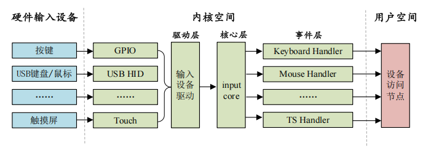

# input子系统
## 定义
input子系统是linux内核针对某一类型的设备而创建的，比如键盘、鼠标、触摸屏、手柄等。input子系统分为以下几部分：input驱动层，input核心层，input事件层。



上图中，最左边的就是具体的设备,这个不用管。
中间部分就是我们要关注的input驱动层，input核心层，input事件层。
驱动层：输入设备的具体驱动程序，比如按键驱动程序，向内核层报告输入内容。
核心层：承上启下，为驱动层提供输入设备注册和操作接口。通知事件层对输入事件进行处理。
事件层：主要和用户空间进行交互。

drivers/input/input.c


```c 
register_chrdev_region(MKDEV(INPUT_MAJOR, 0),
				     INPUT_MAX_CHAR_DEVICES, "input");

```
这个文件中注册了一个类，设备号是13


## 输入设备注册
在使用 input 子系统的时候我们只需要注册一个 input 设备即可，input_dev 结构体表示 input设备，此结构体定义在 include/linux/input.h 文件中，定义如下(部分)

```c
struct input_dev {
	const char *name;
	const char *phys;
	const char *uniq;
	struct input_id id;

	unsigned long propbit[BITS_TO_LONGS(INPUT_PROP_CNT)];

	unsigned long evbit[BITS_TO_LONGS(EV_CNT)];
	unsigned long keybit[BITS_TO_LONGS(KEY_CNT)];
	unsigned long relbit[BITS_TO_LONGS(REL_CNT)];
	unsigned long absbit[BITS_TO_LONGS(ABS_CNT)];
	unsigned long mscbit[BITS_TO_LONGS(MSC_CNT)];
	unsigned long ledbit[BITS_TO_LONGS(LED_CNT)];
```

evbit 表示输入事件类型，可选的事件类型定义在 include/uapi/linux/input.h 文件
中，事件类型如下：

```c
#define EV_SYN			0x00
#define EV_KEY			0x01
#define EV_REL			0x02
#define EV_ABS			0x03
#define EV_MSC			0x04
#define EV_SW			0x05
#define EV_LED			0x11
#define EV_SND			0x12
#define EV_REP			0x14
#define EV_FF			0x15
#define EV_PWR			0x16
#define EV_FF_STATUS		0x17
#define EV_MAX			0x1f
#define EV_CNT			(EV_MAX+1)
```

evbit、keybit、relbit 等等都是存放不同
事件对应的值。比如要使用按键事件，
因此要用到 keybit，keybit 就是按键事件使用的位图，
Linux 内核定义了很多按键值，
这些按键值定义在include/uapi/linux/input.h 文件中，按键值如下：
```c

#define KEY_RESERVED		0
#define KEY_ESC			1
#define KEY_1			2
#define KEY_2			3
#define KEY_3			4
#define KEY_4			5
#define KEY_5			6
#define KEY_6			7
#define KEY_7			8
```